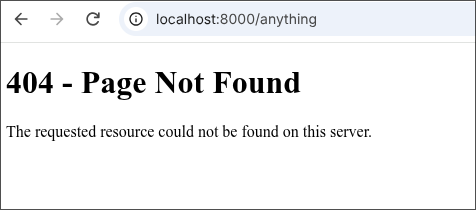

# BSL WebSocket Server

## 1. Project Description
This project is an event-driven WebSocket chat server built using the **[Bonezegei Scripting Language (BSL)](https://github.com/bonezegei/Bonezegei_Scripting_Language)** and the BSL HTTP Library. The server binds to port 8000 and handles both HTTP GET requests and full-duplex WebSocket connections, demonstrating the HTTP-to-WebSocket handshake, client identification, disconnection tracking, and real-time message broadcasting across all active connections.

It handles the following routes and events:
- `/` - WebSocket chat client page (`public/index.html`).
- Any unmapped route (e.g., `/anything`) - Custom 404 Not Found error page (`public/404.html`).
- **onConnect** - Assigns the client an ID and sends it a welcome message.
- **onData** - Broadcasts every received message to all connected clients via `server.sendAll()`.
- **onDisconnect** - Logs the ID of the disconnected client.

## 2. Screenshots Section

### Showcase Video
[▶ Watch the showcase video (Showcase.mkv)](documentation/Showcase.mkv)

### Bonezegei Version (bonezegei -v)


### Installing Dependencies (bzg install)


### Terminal Server Output (bzg run)


### WebSocket Chat Client (/)


### 404 Not Found Page (/anything)


## 3. Installation & Setup Guide

### Installing the BSL Interpreter
**Windows:** Uninstall any previous version, then search for **Bonezegei** in the Microsoft Store and install it.

**Linux / GitHub Codespaces:** Download the release binary and install the package:
```bash
wget https://github.com/bonezegei/Bonezegei_Scripting_Language/raw/refs/heads/main/Release/Latest/Bonezegei-x86.deb
sudo apt install ./Bonezegei-x86.deb
```

Verify that the installed version is **v1.3.3**:
```bash
bonezegei -v
```

### Installing the BSL HTTP Library
Navigate to the root directory of this repository and run the following command to install the dependencies listed in `package.json`:
```bash
bzg install
```

### Running the Server
To start the WebSocket server, execute the following command in your terminal:
```bash
bzg run
```
The server will bind to port 8000 and log HTTP requests and WebSocket events to the terminal.

## 4. Usage Instructions
Once the server is running, you can access the application through your web browser or via `curl`:
- **Chat Client:** Open `http://localhost:8000/` in two or more browser windows. Messages sent from any window are broadcast to every connected window as `User <id> says: <message>`.
- **404 Route:** Navigate to any unknown endpoint like `http://localhost:8000/does-not-exist` to see the 404 error page.

> **Note:** Make sure to use `http://` and not `https://`. The server does not use TLS, so browsers that auto-upgrade to HTTPS will show `SSL_ERROR_RX_RECORD_TOO_LONG`.
